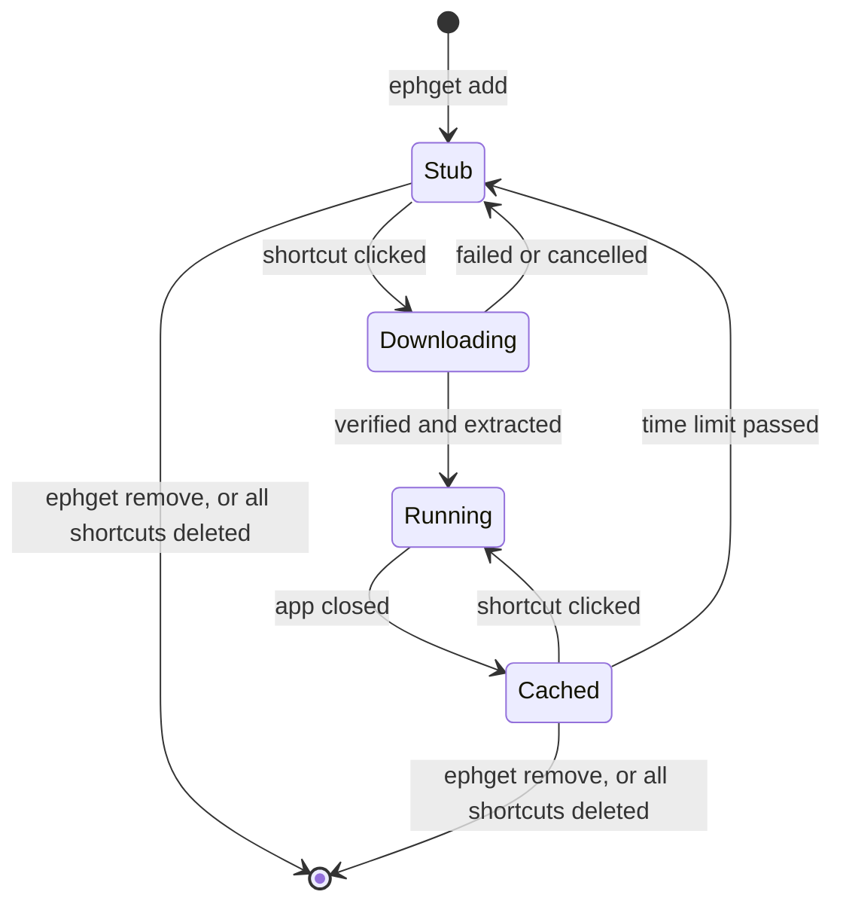

# ephget

Desktop shortcuts for portable Windows apps that download on first use and clean up after themselves.

Some apps you only need once or rarely: a disk utility, a file converter, a one-off viewer. Installing them leaves clutter behind. With ephget, the shortcut exists before the app does. The first click downloads the app, and once you've gone a while without using it, the app is deleted. The shortcut stays, so the next click brings it back.

> **Status: not released yet.** The install line below won't work until the first release is published, and ephget hasn't yet been tested on a clean machine.

## Install

In PowerShell:

```powershell
irm https://github.com/Dryd33n/ephget/releases/latest/download/install.ps1 | iex
```

It needs no admin rights. Run it again to update. To read the script first, it's [install.ps1](install.ps1).

Windows Defender or SmartScreen may warn about ephget, because it isn't code-signed yet and it downloads and starts other programs.

## Use

```powershell
ephget search pdf            # find an app
ephget add sumatrapdf        # create its shortcuts; nothing downloads yet
```

Then double-click the shortcut. After that:

| Command | What it does |
| --- | --- |
| `ephget list` | Shows your apps and when each will be removed |
| `ephget set <id> --ttl 1h` | Changes how long an app is kept after you close it |
| `ephget set <id> --no-keep-prefs` | Deletes an app's settings along with it |
| `ephget set <id> --pin` | Stays on this version instead of the latest |
| `ephget remove <id>` | Deletes an app, its shortcuts and its saved settings |
| `ephget config` | Shows or changes the defaults for new apps |
| `ephget uninstall` | Removes ephget and everything it added |

An app is kept for 7 days after you last closed it, unless you choose otherwise, and an open app is never removed. Settings are kept by default, so an app comes back the way you left it.

## How an app moves through ephget



## The app catalog

The catalog comes from the manifests in [Scoop](https://scoop.sh)'s buckets, but ephget doesn't use Scoop and never runs a manifest's scripts. Every download is checked against the manifest's SHA256 hash before it's unpacked.

It only includes apps that work without those scripts, so it leaves out many apps that need a real installer. [Ways to expand the catalog](docs/expanding-the-catalog.md) covers what's missing and why.

A daily [workflow](.github/workflows/build-index.yml) rebuilds the catalog from the code in [`index/`](index/README.md).

## What it does on your PC

- **Files:** everything lives in `%LOCALAPPDATA%\ephget`, apart from the shortcuts.
- **In the background:** an hourly scheduled task, `ephget-reap`, removes expired apps. It runs for a moment and exits. A small launcher also waits while an ephget app is open, to record when it closes.
- **Network:** ephget only connects to refresh the catalog and to download an app that isn't cached.
- **Settings:** an app's settings are found on a best-effort basis. Turning off keep-preferences can leave some behind.

## Build from source

You need Go. In PowerShell:

```powershell
./build.ps1       # builds dist\ephget.exe and dist\ephgetw.exe
go test ./...     # the end-to-end tests briefly open a console window
```

Set `EPHGET_HOME` to a test folder before trying it out, so nothing touches a real installation.

The full design is in the [specification](<ephget — Software Specification.md>).

## Licences

ephget is free software under the [GNU General Public License](LICENSE), version 3 or any later version. You can use, change and share it, and anything you distribute based on it must come with its source under the same licence.

The third-party code in ephget's executables is listed in [THIRD_PARTY_NOTICES.md](THIRD_PARTY_NOTICES.md), and the catalog's sources in [index/NOTICE.md](index/NOTICE.md). Each app ephget downloads has its own licence.
