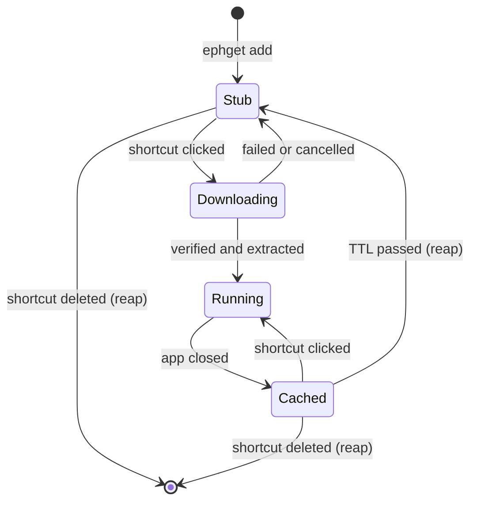
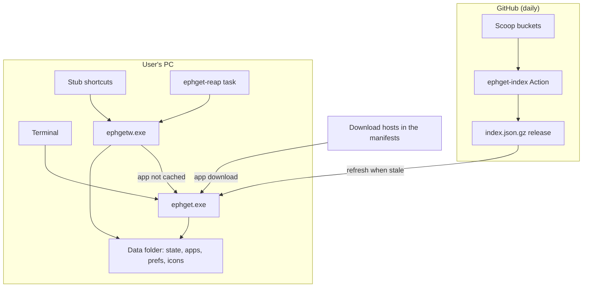

# ephget — Software Specification

Nov 4, 2026 · @Dryden · Draft v0.1

## 1. Overview

ephget is a lightweight Windows tool that puts desktop shortcuts for portable apps on the desktop, downloads the app only when a shortcut is first clicked, and deletes it after a period of disuse. It uses the manifests in Scoop's community buckets as its catalog but never installs or runs Scoop, and never runs a manifest's scripts.

### Problem

Many apps are needed once or rarely: a disk utility, a file converter, a one-off viewer. Installing them leaves clutter, and existing package managers (WinGet, Scoop, Chocolatey) have no concept of expiry or on-demand stub shortcuts.

### Goals

- Desktop shortcuts that exist before the app does, and fetch it on first click.
- Automatic removal of apps not used within a configurable time-to-live (TTL), counted from when the app was last closed.
- A per-app "keep preferences for next time" toggle that either keeps or removes the app's settings when it expires.
- Search across all eligible GUI apps in the catalog.
- Minimal footprint: nothing running unless an ephget app is open, no admin rights, one small executable.
- Every download verified against the catalog's SHA256 hash.

### Non-goals

- Installing apps that use real installers (exe, msi, msix setup programs), including setup programs Scoop unpacks.
- Running Scoop or any PowerShell from a manifest. Apps whose scripts can't be skipped or replaced by a simple rename are left out.
- Command-line tools; a desktop shortcut doesn't suit them.
- Guaranteed removal of every setting an app writes to `%APPDATA%` or the registry; settings cleanup is best-effort (section 7).
- Version pinning or reproducible installs.
- Running on platforms other than Windows 10/11.
- Replacing WinGet or Scoop as a general package manager.

## 2. Glossary

| Term | Meaning |
| --- | --- |
| Stub shortcut | A `.lnk` that runs `ephgetw.exe run <id>` with the app's settings; exists whether or not the app is downloaded. |
| App ID | The Scoop manifest name, e.g. `vlc`. |
| Bucket | A Git repository of Scoop app manifests, e.g. `ScoopInstaller/Extras`. |
| Index | The prebuilt, compressed list of eligible apps published by ephget-index. |
| Eligible app | A GUI app in a surveyed bucket that meets the rules in section 6. |
| Persist list | The files and folders a Scoop manifest says hold the app's settings inside its own folder. |
| TTL | Time-to-live: how long after the app was last closed it is kept before removal. Default 7 days; minimum 1 hour. |
| Reap | The cleanup pass that deletes apps past their TTL. |
| Keep preferences | Per-app toggle, default on. On: the app's settings survive reaping. Off: settings ephget detected are deleted with the app. |
| Settings footprint | The `%APPDATA%`, `%LOCALAPPDATA%` and `HKCU\Software` entries an app created on its first run, as detected by ephget. |
| Cached | The app's files are present locally and can launch without network access. |

## 3. User-facing behaviour

Users interact with ephget through a small CLI and through the desktop shortcuts it creates. A search GUI is out of scope for v1.

### Installation

There is no separate setup step. Installing ephget (a one-line PowerShell installer, or later a WinGet package) copies `ephget.exe` and `ephgetw.exe` to `%LOCALAPPDATA%\ephget\`, adds that folder to the user `PATH`, and registers the `ephget-reap` scheduled task. Every CLI command also checks that the task exists and re-registers it if missing, so a deleted task heals itself.

### Commands

| Command | Behaviour |
| --- | --- |
| `ephget search <query>` | Fuzzy-matches ID, name and description in the index; prints ID, name, version and description. |
| `ephget add <id> [--ttl 7d] [--keep-prefs \| --no-keep-prefs] [--pin] [--dir <folder>] [--no-start-menu]` | Creates stub shortcuts. Does not download the app. |
| `ephget set <id> [--ttl 1h] [--keep-prefs \| --no-keep-prefs] [--pin \| --no-pin]` | Changes an app's settings and rewrites its known stubs to match. |
| `ephget list` | Shows shortcuts, cached apps, version and pin, last close and time until removal. |
| `ephget config [--ttl] [--keep-prefs \| --no-keep-prefs] [--shortcut-dir <folder>] [--start-menu \| --no-start-menu]` | Shows or sets the defaults used by `add`. |
| `ephget uninstall` | Removes all cached apps, stubs, the scheduled task, the PATH entry and the data folder. |
| `ephget fetch <id> [--pin <version>]` | Started by `ephgetw run` when the app isn't cached, not typed by users. Refreshes the index if stale, then downloads, verifies and extracts the app in a console window. |
| `ephgetw run <id> [--ttl] [--keep-prefs \| --no-keep-prefs] [--pin <version>]` | Stub target, not typed by users. Starts `ephget fetch` if not cached, launches the app, records when it closes. |
| `ephgetw reap` | Deletes cached apps past their TTL. Run by the scheduled task. |

Defaults: TTL 7 days, keep preferences on, shortcuts on the Desktop and in the Start Menu.

Removing an app has no command: the user deletes its shortcut (F8).

### Expiry and preferences

- **TTL:** an app is removed once `now > last_closed + ttl`. Counting from close rather than launch means an app left open for days is never treated as idle. Default TTL is 7 days; accepted units are hours and days, minimum 1 hour.
- **Keep preferences for next time:** a per-app toggle. When on, the app's settings survive reaping, so a re-download starts where it left off: settings outside the app folder stay where they are, and those on its persist list are saved first and restored on the next download. When off, ephget deletes them along with the settings footprint it detected (section 7). Default: on.

There is no delete-on-exit mode. An accidental close would lose the app; a 1-hour TTL covers the same need safely.

Removing a cached app never removes its shortcut. The next click downloads the latest version again.

### First-run experience

Decided: option A. When a shortcut is clicked and the app is not cached, `ephgetw.exe` starts `ephget.exe` in a new console window, which shows its own progress. The options considered:

| Option | Pros | Cons |
| --- | --- | --- |
| A. Console window showing ephget's own output (download %, verify, extract), closing on success | Transparent; no UI code, since `ephget.exe` is already a console program; closing the window cancels | Plainer look; brief console flash on first run |
| B. Terminal running `winget install` | Shows WinGet's familiar output | Brings WinGet back as a runtime dependency; slower (source update); installs into WinGet's folders, which ephget would then have to track |
| C. Native TaskDialog with a progress bar | Most polished | More Win32 code; hides what is actually happening |

A gives the terminal-style transparency of B without making WinGet a runtime dependency. The window closes on success; on failure it stays open with the error and a retry prompt. Closing it cancels the download.

## 4. User flows

Every app moves through four states, and reaping returns it to a stub rather than removing it. The stub is the app: deleting the shortcut is how a user removes an app, and there is no remove command.



### F1. Install ephget

1. User runs the one-line installer.
2. The installer shows the default shortcut locations, Desktop and Start Menu, and asks the user to confirm. They can paste a different folder to use instead of the Desktop, and can turn the Start Menu entries off.
3. `ephget.exe` and `ephgetw.exe` are copied to `%LOCALAPPDATA%\ephget\`, the answers are saved to `config.json`, the folder is added to the user `PATH`, and the `ephget-reap` task is registered.
4. `ephget` is available in any new terminal. Nothing else changes on the system.

### F2. Find and add an app

1. `ephget search vlc` lists matching portable apps (ID, name, version).
2. `ephget add vlc` (optionally `--ttl 1h`, `--no-keep-prefs`, `--dir <folder>`, `--no-start-menu`).
3. Shortcuts named after the app appear in the shortcut folder and, if enabled, the Start Menu, with ephget's generic icon. Nothing is downloaded.

### F3. First launch (not cached)

1. User double-clicks the shortcut.
2. `ephgetw` starts `ephget fetch` in a console window: refresh index if stale → download with progress → verify SHA256 → extract.
3. The shortcut's icon changes to the app's own icon.
4. The console closes and `ephgetw` starts the app, snapshotting settings locations first.
5. When the user closes the app, ephget records the close time and the detected settings footprint.

### F4. Cached launch

1. User double-clicks the shortcut.
2. The app starts with no visible ephget window and no network access.
3. On close, the close time is recorded.

### F5. Expiry

1. The hourly task finds an app whose last close is older than its TTL and which isn't running.
2. If keep preferences is on, the app's persist-list items are saved to `prefs\<id>\`. The app folder is then deleted. If keep preferences is off, its settings footprint is deleted too.
3. The shortcut stays, with the app's icon. The next click is F3; with keep preferences on, the app opens with its old settings.

### F6. Change an app's settings

1. `ephget set <id> --ttl 1h` or `--keep-prefs` / `--no-keep-prefs` updates that app.
2. `ephget config --ttl … --keep-prefs …` changes the defaults for future `add`s.
3. Changes apply from the next reap pass; nothing is downloaded or deleted immediately.

### F7. Check status

1. `ephget list` shows each shortcut: cached or not, version, last close, time until removal, keep-preferences setting and footprint.

### F8. Remove an app

1. User deletes the shortcut, like any other file.
2. On the next reap pass (within the hour), ephget sees that none of the app's shortcuts exist and treats it as expired immediately, whatever its TTL.
3. The cached app is deleted, along with its settings if keep preferences is off, and the state entry and icon are dropped. Nothing of the app remains.

### F9. Uninstall ephget

1. `ephget uninstall` finds every stub (recorded paths, then a scan) and lists everything that will be removed, then asks for confirmation.
2. All cached apps, the found stubs, the scheduled task, the PATH entry and the data folder are deleted. Settings outside the data folder follow each app's keep-preferences setting; settings saved in `prefs\` go with the data folder, and the confirmation says so.
3. Stubs that couldn't be found are listed by last known path so the user can delete them. Clicked after uninstall, they show Windows' standard "missing target" prompt, since ephgetw.exe is gone.

### Exception flows

| Situation | What the user sees | What ephget does |
| --- | --- | --- |
| Offline on first launch | Console shows the error and a retry prompt | Nothing changes; cached apps still work |
| Hash mismatch | Console error: download failed verification | Deletes the download; app stays a stub |
| App's exe missing after extraction (usually a manifest script that shouldn't have been skipped) | Console error naming the missing file | Deletes the extracted files; app stays a stub |
| User closes the console mid-download | Window closes | Cancels, cleans `tmp\`, app stays a stub |
| App removed from the index | Console error on first launch; `ephget list` flags it | A cached copy keeps working until it expires |
| Shortcut clicked twice during download | Second click waits on the first | Download lock; both launch once it finishes |
| Stub moved to another folder | Nothing; it keeps working | Next launch records its new path |
| Stub clicked with no state entry (moved, then its state was dropped) | Same as a first launch | Rebuilds the state entry from the stub's own arguments (ID, TTL, keep-prefs) |
| App launched outside the shortcut | Nothing | Not tracked; reaper treats it as just closed whenever it finds it running |
| PC shuts down with the app open | Nothing | No close time recorded; launch time used as fallback |

## 5. System architecture

ephget has two parts: an index pipeline that runs in the cloud, and the client on the user's PC. The client is two builds of the same code: `ephget.exe` for the terminal, and `ephgetw.exe`, which the stubs and the scheduled task start without any console window.



The client only talks to the internet to refresh the index and to download an app that isn't cached, and only `ephget.exe` does either. `ephgetw.exe` never touches the network; a cached launch touches nothing but `state.json`.

## 6. Index pipeline (ephget-index)

A scheduled GitHub Action in a separate `ephget-index` repository builds the index once a day and publishes it as a release asset. Clients never read Scoop's buckets directly, apart from the pinned-version fallback (section 7).

### Source

- Shallow clones of the `ScoopInstaller` buckets `Main`, `Extras`, `Nirsoft`, `Sysinternals` and `Games`, cached between runs. If two buckets have the same app ID, the first in that order wins.
- `Versions`, `Nonportable`, `PHP`, `Java` and the nerd-fonts bucket are excluded: they hold old releases, installers, runtimes and fonts rather than current desktop apps.
- Each run diffs against the previous commit and re-parses only changed manifests; unchanged entries carry over from the previous index.

### Eligibility rules

An app is included if its manifest has an x64, arm64 or architecture-independent build where all of these hold:

1. **GUI app:** the manifest has a `shortcuts` entry, which also gives the exe to launch and the shortcut's name.
2. **One download:** a single URL, with a SHA256 hash. Manifests with only MD5 or SHA-1 hashes, or none, are excluded.
3. **Unpackable file:** a `.zip`, a real `.7z`, or an exe that runs as it is. Setup programs are excluded, including exes Scoop opens as 7z (`#/dl.7z`), `innosetup` apps and `.msi` files.
4. **No dependencies:** the manifest has no `depends` field.
5. **No script needed:** see below.

**Manifest scripts are never run.** The indexer classifies each manifest's `installer`, `pre_install` and `post_install` scripts:

| Script | Treatment |
| --- | --- |
| None | Included. |
| Only prepares settings: creates config files, copies old settings, removes spare files | Skipped; included. |
| One simple rename of the exe to the launch name | Replaced by the installer's `rename` field; included. |
| Runs a setup program, unpacks files, starts programs, edits the registry or downloads anything; moves or renames other program files | Excluded. |

The classification uses keyword matching, so it can misjudge a script. The client checks for the exe after extraction and fails with a clear error if it's missing. Scripts that are skipped can leave different defaults: for example, an app's update check may stay on.

### Schema

The `packages` array, one object per app:

```json
{
  "id": "vlc",
  "name": "VLC media player",
  "bucket": "Extras",
  "version": "3.0.24",
  "description": "A free and open source cross-platform multimedia player.",
  "persist": ["portable"],
  "installers": [
    {
      "arch": "x64",
      "type": "7z",
      "url": "https://...",
      "sha256": "...",
      "exe": "vlc.exe",
      "extract_dir": "vlc-3.0.24",
      "rename": null
    }
  ]
}
```

`arch` is `x64`, `arm64` or `any`. `type` is `zip`, `7z` or `exe`. `extract_dir` is the folder inside the archive to use as the app's root. `rename` is either null or a `[glob, name]` pair. The example's values are illustrative. Licences and release notes are deliberately left out to keep the index small.

### Publishing

- Artifact: `index.json.gz` attached to a rolling `latest` release of `Dryd33n/ephget-index`, plus `index.json.gz.sha256`.
- Client URL: `https://github.com/Dryd33n/ephget-index/releases/latest/download/index.json.gz`.
- Schema version in a top-level wrapper (`{"schema": 1, "generated": "<ISO time>", "packages": [...]}`) so clients can refuse an index format they don't understand.
- Target size: under 300 KB compressed. A test build in nearly this format, with 1,663 apps, came to about 219 KB.

## 7. Client design

The client is one Go codebase built as two executables, following the `python.exe` / `pythonw.exe` pattern:

- `ephget.exe` — console subsystem. Every command a user types, plus `fetch` for first-run downloads. Behaves like any CLI: waits, returns exit codes, supports prompts and piping. The only build that uses the network.
- `ephgetw.exe` — GUI subsystem. Target of every stub and of the scheduled task, so neither ever flashes a console window. Handles only `run` and `reap`, never opens a console and never uses the network. When an app isn't cached, it hands the download to `ephget fetch`.

The two differ only in a build flag and a small entry point that exposes their commands; all logic lives in shared internal packages.

### Data layout

```
%LOCALAPPDATA%\ephget\
  ephget.exe         CLI (console)
  ephgetw.exe        stub and task target (GUI)
  config.json        defaults: TTL, keep-prefs, shortcut folder, Start Menu on/off
  index.json.gz      cached index + ETag
  state.json         per-app state (a cache; stubs are the source of truth)
  apps\<id>\<version>\  extracted app files
  prefs\<id>\        persist-list items saved while the app isn't cached
  icons\<id>.ico     extracted icons
  tmp\               in-progress downloads
```

No registry keys are written apart from the scheduled task.

### State file

```json
{
  "vlc": {
    "bucket": "Extras",
    "version": "3.0.24",
    "path": "apps\\vlc\\3.0.24",
    "exe": "vlc.exe",
    "persist": ["portable"],
    "last_launched": "2026-11-04T01:05:00Z",
    "last_closed": "2026-11-04T02:40:00Z",
    "ttl": "7d",
    "keep_prefs": true,
    "pin": {
      "version": "3.0.24",
      "url": "https://...",
      "sha256": "..."
    },
    "shortcuts": [
      "%USERPROFILE%\\Desktop\\VLC media player.lnk",
      "%APPDATA%\\Microsoft\\Windows\\Start Menu\\Programs\\ephget\\VLC media player.lnk"
    ],
    "footprint": [
      "%APPDATA%\\vlc",
      "HKCU\\Software\\VideoLAN"
    ]
  }
}
```

Writes go to a temp file followed by an atomic rename, guarded by a lock file, so concurrent launches cannot corrupt it.

### Launch path (`ephgetw run <id>`)

1. Read `state.json`. If the app is cached and its folder exists, go to step 3.
2. Start `ephget fetch <id>` in a new console window (`CREATE_NEW_CONSOLE`), passing `--pin` if the stub has it, and wait for it to exit. If a fetch for this app is already running, wait for that one instead of starting a second. If the fetch fails or the user closes its window, exit without launching.
3. If this is the app's first run, snapshot the settings locations (see Settings footprint).
4. Write `last_launched = now`, start the app with `CreateProcess`, and wait. The wait ends when no process whose image path is inside the app folder is still running, which covers apps that hand off to a child process and exit.
5. Write `last_closed = now`. On first run, diff the snapshot and store the footprint.
6. Run a reap pass, then exit.

A cached launch performs no network access and reads no index. While waiting, the launcher blocks on process handles: a few MB of memory and no CPU.

### Download path (`ephget fetch <id>`)

1. Load the index (refresh first if older than 24 h) and pick the installer for the machine's architecture, preferring native over x64 emulation on arm64.
2. Download to `tmp\` with progress shown (section 3); verify SHA256. On mismatch, delete and fail.
3. Extract (zip, 7z) or move (exe) into `apps\<id>\<version>\`, using `extract_dir` as the root if set and applying `rename` if set. If the launch exe isn't there, delete the files and fail. Clear the Mark of the Web; extract the exe's icon to `icons\<id>.ico` and update the shortcut's icon.
4. Move any saved settings from `prefs\<id>\` back into the app folder. Record the version and path in `state.json` and exit 0. On failure, show the error and a retry prompt; if the user declines, exit non-zero.

### Reaper (`ephgetw reap`)

For each entry in `state.json`:

1. **Check for stubs.** If none of the recorded `shortcuts` exist, scan for the app's `ephget:<id>` marker (Finding stubs) in case the stub was moved but not yet clicked. If a stub is found, update its path; if none is, the user deleted the app: treat it as expired now and go to step 3.
2. Skip it if `now <= last_closed + ttl`. If `last_closed` is missing (the launcher was killed or the PC shut down with the app open), use `last_launched`.
3. Try to rename the app folder to `<folder>.reaping`. If the rename fails, the app is running: set `last_closed = now` and skip it.
4. If `keep_prefs` is on and the user hasn't deleted the app, move each `persist` item that exists out of the renamed folder into `prefs\<id>\`. Delete the renamed folder. If `keep_prefs` is off, also delete each footprint entry that still exists and any `prefs\<id>\`.
5. If the app was deleted by the user, drop the state entry and its icon. Otherwise keep the entry, minus the cache path, so the stub stays ready to relaunch.

The marker scan only runs when every recorded path is missing, which is rare, so the hourly pass normally stays a plain file read.

**Triggers:** the `ephget-reap` per-user scheduled task runs at logon and hourly, with "run as soon as possible after a missed start", so a 1-hour TTL is honoured within about an hour. Each run reads one JSON file and exits. A reap pass also runs after every app closes.

**Load:** each hourly run starts ephgetw.exe, reads a state file of a few KB, compares timestamps and exits. Expect roughly 20–50 ms of CPU and a few MB of memory for that moment, no network, and no disk writes unless something expired: about a second of CPU per day. The task is set not to wake the PC and to run only while the user is logged on. These are estimates to confirm with a benchmark in M3.

### Settings footprint

Many portable apps keep settings next to their exe, and reaping deletes that folder. The manifest's `persist` list names those items where it has one, so ephget saves them to `prefs\<id>\` and restores them on the next download. Settings in the app folder that aren't on the list are lost when the app is reaped.

For settings outside the app folder, ephget detects where an app keeps them by comparing before and after its first run.

1. Before the first launch, record the names of the top-level entries in `%APPDATA%`, `%LOCALAPPDATA%` and `HKCU\Software`, plus one level under each `HKCU\Software\<vendor>` key.
2. After the app closes, list them again. New entries are candidates.
3. Keep only candidates whose name matches the app's ID or name, which filters out folders other programs created in the same window.
4. Store the result in the state entry's `footprint`; `ephget list` shows it.

The footprint is always recorded, so the keep-preferences toggle can be changed later. Detection is best-effort: settings written inside an existing shared folder, under an unrelated name, or only on a later run are missed.

### Shortcuts and icons

- `ephget add` creates a `.lnk` in the shortcut folder (the Desktop unless the user chose another) and, unless disabled, in `Start Menu\Programs\ephget\`, via the Shell `IShellLink` COM interface. Target: `ephgetw.exe run <id> --ttl <ttl> --keep-prefs|--no-keep-prefs`. Its paths are stored in the state entry's `shortcuts`.
- The stub carries all of the app's settings in its arguments, so `state.json` is only a cache: a stub can always rebuild its entry.
- Until first run the shortcut uses ephget's own generic icon. After first extraction it points to `icons\<id>.ico`, which survives reaping.

### Finding stubs

Users can move or copy stubs anywhere, so ephget never relies only on the paths it created.

1. **Track on launch.** When Windows starts a program from a shortcut, it passes the `.lnk` path in the startup info (`STARTF_TITLEISLINKNAME`). Every `run` records that path in `shortcuts`, so a moved stub is re-learned the first time it is clicked.
2. **Identify by content.** Every stub's arguments start with `run <id>` and its description field carries an `ephget:<id>` marker, so any `.lnk` can be recognised without a lookup table.
3. **Scan when needed** (`uninstall`, `set`, and the reaper's deleted-shortcut check). Check the recorded paths first; then scan the configured shortcut folder, the user and public Desktop, the Start Menu, the taskbar pin folder and the user's Documents and Downloads for `.lnk` files with the marker.
4. **Report what's left.** Stubs not found are listed by last known path for manual deletion.

### Index refresh

- Refreshed only by `ephget.exe`, during `search`, `add` and `fetch`, when the local copy is older than 24 h.
- Uses `If-None-Match` with the stored ETag; a 304 response costs no download.
- If refresh fails, the stale index is used and a warning is printed.

### Versions and updates

A cached app is never updated in place. Whenever an app has to be downloaded (first launch, or after it expired), ephget fetches the latest version in the index by default.

- `--pin` on `add` or `set` freezes the app at the version that is cached, or at the version downloaded next if none is. The stub's arguments gain `--pin <version>`, and the state entry's `pin` field stores that version's number, URL and SHA256. Unpinned apps have no `pin` field.
- The index only lists latest versions, so a pinned re-download uses the stored URL and hash. If the state entry is gone, ephget looks up that version's manifest in the bucket's Git history on GitHub.
- If the pinned version's download no longer exists (publishers sometimes remove old files), the console says so and offers to unpin and get the latest.
- `--no-pin` returns the app to latest-on-download.

## 8. Non-functional requirements

Lightweight is the primary design constraint: when no ephget app is open, ephget uses no CPU, no memory and no network.

| ID | Requirement | Target |
| --- | --- | --- |
| NF-1 | No background process when no app is open | Only a waiting launcher per open app (a few MB, no CPU), plus the brief hourly reap |
| NF-2 | Cached launch overhead | < 50 ms from click to `CreateProcess` |
| NF-3 | Binary size | < 10 MB per exe, stripped (`-ldflags "-s -w"`) |
| NF-4 | Dependencies | Go standard library + direct Win32/COM calls + one pure-Go 7z reader; no GUI framework, no Scoop, no PowerShell at runtime, no external 7z/lessmsi |
| NF-5 | Index download | < 300 KB compressed; daily check normally a 304 |
| NF-6 | Privileges | Never requires admin; per-user task and paths only |
| NF-7 | Supported OS | Windows 10 (1809+) and 11, x64 and arm64 |
| NF-8 | Footprint after uninstall | Data folder, PATH entry and scheduled task removed; nothing else left by ephget |

### Security

- Every download is verified against the SHA256 from the Scoop manifest before extraction; a mismatch aborts and deletes the file.
- Scripts in manifests are never run, and never included in the index.
- Manifests choose their download hosts, and some use third-party mirrors. The hash proves the file matches the manifest, not that it came from the publisher.
- Downloads go only to URLs present in the index; the index is fetched over HTTPS from the ephget-index releases.
- Mark of the Web is cleared only after hash verification succeeds.
- Zip extraction rejects entries with absolute paths or `..` components (zip-slip).
- The index itself is unsigned in v1. Hash checks protect against a tampered download or mirror, not against a compromised index, which controls both the URL and the hash. Signing the index is the fix if this matters later.

## 9. Known limitations and open questions

### Limitations

- **Settings detection is best-effort:** with keep preferences off, settings the footprint missed (shared folders, unrelated names, later runs) stay behind.
- **Launches that bypass the shortcut** aren't tracked, so `last_closed` isn't updated. The reaper still refreshes it whenever it finds the app running, so the worst case is an early re-download.
- **Catalog coverage** leaves out apps that need a setup program, an unfixable script or a non-SHA256 hash, including GIMP, 7-Zip, KeePass, Krita, Audacity, CrystalDiskInfo, Firefox and Everything.
- **Skipped scripts** can change an app's defaults, and the script classification is keyword-based, so some included apps may fail or behave differently.
- **Reliance on Scoop's buckets:** ephget doesn't use Scoop itself, but its catalog depends on the buckets continuing to be updated. If they stop, the index goes stale and old download URLs start failing.
- **arm64:** only 228 of the 1,663 eligible apps list an arm64 build. Others that have no architecture-independent build run under x64 emulation.
- **SmartScreen** may still warn on unsigned executables even after Mark of the Web is cleared, depending on system policy.

### Open questions

- [x] How many eligible apps does the catalog contain? 1,663 GUI apps in Scoop's buckets (M0).
- [ ] Is it fine to redistribute manifest data from each bucket? `Main` and `Extras` use the Unlicense and `Nirsoft` and `Sysinternals` use MIT, but the `Games` licence is Creative Commons and still needs reading.
- [ ] How often does skipping a script actually break an app? Answered by the sample test in M2.

## 10. Milestones

Each milestone ends with a usable result; no dates are set yet.

### M0 — Catalog survey

Answers the one go/no-go question: are there enough useful portable apps in the catalog?

- [ ] Create `Dryd33n/ephget` and `Dryd33n/ephget-index` repos.
- [x] Survey WinGet: 3,682 of 15,949 packages are portable, but utilities like CPU-Z, HWiNFO and WizTree are installer-only there, so it was dropped as the catalog.
- [x] Survey Scoop's buckets and apply the eligibility rules (section 6): 1,663 of 4,941 apps.
- [x] Output the eligible count, breakdowns, and a CSV of eligible apps.
- [ ] Check the list for 20 apps you'd actually use.

**Done when:** you have the count and the spot-check, and can call go or no-go.

### M1 — Index pipeline

- [ ] Turn the survey script into the indexer: emit schema-1 `index.json.gz` and its `.sha256`.
- [ ] Add per-architecture entries, `extract_dir`, `rename`, `persist` and the shortcut name to the index.
- [ ] Store each bucket's last processed commit; re-parse only manifests changed since (`git diff --name-only`).
- [ ] GitHub Action on a daily schedule plus manual trigger, caching the clones between runs.
- [ ] Upload to the rolling `latest` release.
- [ ] Fail the build if the index exceeds 300 KB or any entry lacks a URL, hash or exe path.
- [ ] Read the `Games` bucket licence; drop the bucket if it doesn't allow this use.

**Done when:** the client URL serves a fresh index every day and a repeat request with the ETag returns 304.

### M2 — Core client

- [ ] Go module with shared internal packages and two entry points: `ephget.exe` (console) and `ephgetw.exe` (GUI subsystem).
- [ ] `config.json` load and save with defaults (TTL 7 days, keep preferences on, Desktop + Start Menu).
- [ ] Index fetch with ETag, gzip decode, fuzzy search; `search` command.
- [ ] `add`: create stubs via `IShellLink` targeting `ephgetw.exe`, with full arguments and the `ephget:<id>` marker, in the shortcut folder and the Start Menu if enabled.
- [ ] `fetch`: pick the installer for the machine's architecture, show progress in the console, download, verify SHA256, extract zip or 7z with zip-slip protection, apply `extract_dir` and `rename`, check the exe exists, clear Mark of the Web.
- [ ] Download and launch a sample of 20–30 eligible apps with skipped scripts, in a VM; fix the classifier for anything that breaks.
- [ ] `run`: if not cached, start `ephget fetch` in a new console and wait for it, exiting if it fails. Launch with `CreateProcess`, wait until no process from the app folder remains, record launch and close times.
- [ ] `state.json` with a lock file and atomic writes; rebuild entries from stub arguments when missing.
- [ ] `list` command.

**Done when:** on a clean machine, search → add → click downloads and runs the app, and a second click starts it instantly while offline.

### M3 — Expiry

- [ ] TTL parsing (hours and days, minimum 1 hour).
- [ ] Reaper as specified in section 7, including the deleted-shortcut check.
- [ ] Register the per-user `ephget-reap` task (logon + hourly, no wake); re-register from any CLI command if missing.
- [ ] Reap pass after each app closes.
- [ ] `set` and `config` commands.
- [ ] Benchmark the hourly run's CPU and memory.

**Done when:** an app with a 1-hour TTL is removed within about 2 hours of closing; deleting its shortcut removes it within an hour; a running app is never removed.

### M4 — Preferences and polish

- [ ] Settings footprint: snapshot before first launch, diff after close, name matching.
- [ ] Keep-preferences toggle: save and restore persist-list items when on; delete the footprint and saved items on reap when off.
- [ ] Icon extraction and shortcut icon update.
- [ ] Stub tracking via `STARTF_TITLEISLINKNAME`; marker scan.
- [ ] Version pinning (`--pin`, stored URL and hash, fallback to the bucket's Git history).
- [ ] `uninstall`.
- [ ] Every exception flow in section 4.

**Done when:** every flow in section 4 behaves as written.

### M5 — Release

- [ ] `install.ps1`: show the default shortcut locations for confirmation, accept a pasted folder instead of the Desktop, allow turning the Start Menu off; copy both exes, write `config.json`, add to PATH, register the task.
- [ ] Release builds of `ephget.exe` and `ephgetw.exe` for x64 and arm64 with checksums.
- [ ] Code signing: evaluate free options for open-source projects before release.
- [ ] README with install line, commands and the lifecycle diagram.
- [ ] Optional: a WinGet manifest for ephget itself.

**Done when:** the one-line install works on clean Windows 10 and Windows 11 VMs.
